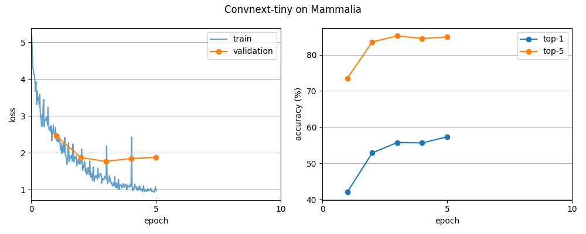

# iNaturalist 2017 Species Classification

This project is a PyTorch training harness for fine-grained species identification on the [iNaturalist 2017](https://github.com/visipedia/inat_comp/tree/master/2017) dataset. The photos are real field observations: one organism per image, often similar-looking species, shot in natural lighting with cluttered backgrounds. The 2017 release has thousands of species in one hierarchy; this repo trains a separate classifier for each super-class so the model only has to tell those species apart.

The comparison is ImageNet-pretrained **ResNet-50** against **ConvNeXt-Tiny** on six super-classes: Amphibia, Arachnida, Fungi, Mammalia, Mollusca, and Reptilia. Both models use the same 320×320 crop, the same augmentations, and the official train/val split. The last linear layer is replaced with one output per species in that super-class. ResNet-50 is trained with SGD; ConvNeXt-Tiny is trained with AdamW. The scripts load those settings from `config/train.json`, write a checkpoint per model and super-class, and can continue a run or score a saved file without training.

Each finished run reports image-weighted top-1 and top-5 accuracy on the validation images for that super-class. That is the fraction of photos labeled correctly, not an average over species.

## Dataset

Images come from the 2017 `train_val_images` release (about 186 GB). Torchvision stores them under `data/2017`. Train and val photos share species folders; the split is defined only in the annotation JSON files, not in the image tree.

| Super-class | ID | Species | Train | Val |
|---|---:|---:|---:|---:|
| Amphibia | 1 | 115 | 15,318 | 2,385 |
| Arachnida | 3 | 56 | 4,873 | 1,086 |
| Fungi | 6 | 121 | 5,826 | 1,780 |
| Mammalia | 8 | 186 | 29,333 | 3,490 |
| Mollusca | 9 | 93 | 7,536 | 1,841 |
| Reptilia | 12 | 289 | 35,201 | 5,680 |

Species counts are the number of kept classes after filtering that super-class.

## Models

| Prompt | Architecture | Weights | Optimizer |
|---|---|---|---|
| `50` | ResNet-50 | ImageNet-1K | SGD |
| `tiny` | ConvNeXt-Tiny | ImageNet-1K | AdamW |

The final linear layer is replaced with one of size `num_classes` for the chosen super-class (`fc` on ResNet-50, `classifier[2]` on ConvNeXt-Tiny).

## Training

Hyperparameters live in [`config/train.json`](config/train.json). Crops are 320×320.

- **Train:** `RandomResizedCrop`, horizontal flip, color jitter, ImageNet normalization, then random erasing
- **Val:** resize shortest side to 320, center crop 320
- **Loss:** cross-entropy with label smoothing 0.1 on the training set only
- **Precision:** mixed precision (`torch.amp`)

ResNet-50 uses SGD at learning rate `1e-3`, momentum `0.9`, and weight decay `5e-4`. ConvNeXt-Tiny uses AdamW at `1e-4` with weight decay `0.05`. Both use a training batch of 64 and a validation batch of 128.

Checkpoints are written to `models/checkpoint_{name}_{order}.pt` after the requested number of epochs. They store weights, optimizer state, epoch, and the loss/accuracy histories used by the plot script. Choosing **continue** (`c`) loads that file and trains further; a new run (`n`) starts from ImageNet weights and overwrites the same path.

## Setup

Python 3.11+ with PyTorch and torchvision (CUDA recommended). From the project root:

```bash
pip install torch torchvision matplotlib
```

1. Let torchvision download the 2017 images into `data/` on the first run, or place `train_val_images` there yourself.
2. Download the 26 MB annotation zip and extract it so these two files exist:
   - `data/train_val2017/train2017.json`
   - `data/train_val2017/val2017.json`
3. Build index files for each super-class:

```bash
python src/subset.py
```

That writes `data/stats/{order}_indices_train.json`, `_indices_valid.json`, and `_kept_classes.json`.

## Usage

Run every script from the project root. Each one asks for a model (`50` or `tiny`) and a super-class number.

```bash
python src/main.py      # train or continue
python src/eval.py      # score a checkpoint on val (does not train or save)
python src/plot.py      # loss and accuracy curves → results/
python src/per_class.py # per-species top-1 on val
```

To drop the learning rate on continue, change `learning_rate` for that model in `config/train.json` before choosing `c`. The continue path copies that value onto the loaded optimizer.

## Results

Validation is image-weighted top-1 / top-5 on the official 2017 val split. ConvNeXt-Tiny is stronger on every super-class in this comparison.

**ConvNeXt-Tiny** (AdamW `1e-4`, 5 epochs)

| Super-class | Top-1 | Top-5 | Val loss |
|---|---:|---:|---:|
| Arachnida | 76.2% | 95.9% | 0.89 |
| Fungi | 74.2% | 94.4% | 1.09 |
| Mollusca | 66.8% | 90.2% | 1.42 |
| Mammalia | 57.3% | 84.9% | 1.87 |
| Amphibia | 47.4% | 83.1% | 1.99 |
| Reptilia | 39.7% | 75.0% | 2.66 |

**ResNet-50** (SGD `1e-3`)

| Super-class | Epochs | Top-1 | Top-5 | Val loss |
|---|---:|---:|---:|---:|
| Fungi | 15 | 65.0% | 91.3% | 1.45 |
| Arachnida | 5 | 38.2% | 72.6% | 2.36 |
| Mollusca | 5 | 33.8% | 65.6% | 2.61 |
| Amphibia | 5 | 24.8% | 52.2% | 3.14 |
| Reptilia | 5 | 22.1% | 52.3% | 3.43 |
| Mammalia | 2 | 21.4% | 42.5% | 3.77 |

**Top-1 comparison**

| Super-class | ConvNeXt-Tiny | ResNet-50 | Gap |
|---|---:|---:|---:|
| Arachnida | 76.2% | 38.2% | +38.0 |
| Fungi | 74.2% | 65.0% | +9.2 |
| Mollusca | 66.8% | 33.8% | +33.0 |
| Mammalia | 57.3% | 21.4% | +35.9 |
| Amphibia | 47.4% | 24.8% | +22.6 |
| Reptilia | 39.7% | 22.1% | +17.6 |



Arachnida is the smallest label set (56 species) and the easiest for both models. Reptilia is the largest (289 species) and the hardest for ConvNeXt-Tiny. Fungi is the closest match: ResNet-50 reaches 65.0% after 15 epochs, against Tiny's 74.2% after 5. Mammalia remains difficult even with more images per class, consistent with similar species and subspecies being confused.

Published iNaturalist 2017 numbers (Van Horn et al., CVPR 2018) are 5,089-way and often per-species averages, so they are not a direct comparison to these super-class, image-weighted scores.
